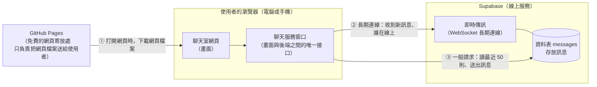

# 匿名聊天室 架構文件

> 這份文件寫給不寫程式的人看。專有名詞第一次出現時，會用一句話解釋。
> 本文件是規劃與設計說明，不含程式碼。階段一（假資料前端）已完成並上線；階段二（接上 Supabase）已實作，實作時與原規劃不同之處，都標示在對應段落。

---

## 1. 專案說明與目標

### 這是什麼

一個不用註冊、不用登入的匿名聊天室。只有一個聊天室，所有知道網址的人都在裡面，電腦和手機都能用。

### 使用者的流程

1. 打開網頁。
2. 輸入一個代號（1 到 12 個字，中文、英文、數字、表情符號都可以）。
3. 進入聊天室，看到最近 50 則訊息、線上有誰，也可以送出訊息。
4. 想離開時按「離開」。

### 已確認的行為

| 項目 | 決定 |
|---|---|
| 新進來的人 | 看得到最近 50 則訊息 |
| 代號重複 | 如果已有人在線上用了這個代號，就擋下來，請對方換一個。那個人離線後，代號就釋出 |
| 重新整理網頁 | 記住上次的代號，自動進入聊天室 |
| 離開 | 有「離開」按鈕；按下後其他人立刻看到「○○ 離開了」，並清掉記住的代號，回到輸入代號的畫面 |
| 訊息長度 | 最多 500 字，不能送出空白訊息；超過時顯示剩餘字數並禁止送出 |
| 髒話與連結 | 都不處理；連結只顯示成文字，不能點 |
| 訊息的外觀 | 顯示代號、內容、時間（例如 14:32）；自己的訊息靠右、別人的靠左；進來、離開的提示是置中的灰色小字 |
| 捲動 | 在最底部時，新訊息自動捲到最新；往上捲時不強制拉到底，改顯示「有新訊息 ↓」按鈕 |
| 線上名單 | 電腦：右側一直顯示，標題「線上 (5)」，自己的代號後面標「（你）」。手機：預設收起來，頂部顯示「線上 5 人」，點一下才展開 |
| 斷線 | 顯示「連線中斷，重新連線中…」，輸入框暫停；連上後自動補上漏掉的訊息 |
| 進出提示 | 斷線超過 30 秒才顯示「○○ 離開了」；30 秒內回來就當作沒離開，不顯示提示 |
| 明暗模式 | 跟著電腦或手機的系統設定，自動切換淺色、深色 |
| 分頁通知 | 切到別的分頁時，網頁標題顯示未讀數，例如「(3) 匿名聊天室」；不發聲音、不跳系統通知 |
| Enter 鍵 | 電腦：Enter 送出，Shift+Enter 換行。手機：Enter 換行，用旁邊的「送出」按鈕送出 |
| 介面語言 | 全部使用繁體中文 |
| 正在輸入（新增） | 別人打字時，輸入框上方顯示「○○ 正在輸入…」；對方送出訊息、離開，或停止打字約 4 秒後消失 |
| 發送頻率限制（新增） | 同一個代號，10 秒內最多送 5 則；第 6 則會被擋下，提示「送太快了，請稍等幾秒再送」，輸入框的內容保留。由資料庫擋，不能繞過網頁 |
| 保留代號（新增） | 不能使用「系統」「管理員」「system」「admin」，也不能包含零寬字元等看不見的字元；輸入代號畫面有說明 |

### 目標

- 先把前端（使用者在瀏覽器上看到、操作的部分）做好，放到網路上看得到。
- 最後才接上 Supabase（提供資料庫和即時傳訊的線上服務），讓真的有很多人能同時聊天。
- 全程使用免費服務，不需要自己架伺服器。

---

## 2. 整體架構圖



### 怎麼看這張圖

- **GitHub Pages** 只是「放網頁檔案的地方」。使用者打開網址時，它把網頁送到使用者的瀏覽器，之後就沒事了。聊天內容**不會**經過它。
- **Supabase** 才是真正存訊息、傳訊息的地方。瀏覽器直接跟它說話。
- **我們沒有自己的伺服器。** 沒有一台電腦需要 24 小時開著替我們處理訊息。
- 圖中的「聊天服務窗口」是程式內部的設計，第 4 節會說明，它讓我們能分兩階段完成專案，不必重寫。

> **WebSocket** 是瀏覽器和伺服器之間「保持不掛斷的電話線」。一般網頁是問一次、答一次；有了這條線，伺服器有新訊息時可以主動立刻通知你，聊天室才能即時。

---

## 3. 技術選擇

每一項都寫「選了什麼」和「為什麼」。

### 3.1 前端的語言與框架

**選了什麼：** Vite + React + TypeScript

- **TypeScript**：寫程式用的語言。它是在 JavaScript（網頁唯一原生的程式語言）上加上「資料格式檢查」。
- **React**：一套幫忙組裝網頁畫面的工具（框架）。
- **Vite**：一個把我們寫的程式整理、打包成網頁檔案的工具。

**為什麼：**

- 聊天室的畫面一直在變：新訊息進來、線上名單增減、連線中斷、未讀數。React 擅長「資料一變，畫面自動跟著更新」，比手動維護不容易出錯。
- React 顯示別人送的內容時，預設當成純文字，不會執行。這直接幫我們擋掉一大類惡意內容（見第 9 節）。
- TypeScript 讓「一則訊息長什麼樣子」有明確定義，寫錯格式會在開發時就被發現，不用等使用者遇到。
- Vite 打包出來是純靜態檔案，正好符合 GitHub Pages 只能放靜態檔案的限制。
- 你要用的 `/frontend-design` 工具，輸出 React 元件很方便。

**沒選的：**

- Next.js 之類的全端框架：需要伺服器才能發揮功能，GitHub Pages 用不到。
- 純 HTML 加 JavaScript：一開始簡單，但功能一多（斷線重連、捲動、未讀、手機版面），程式會變得很難維護。

### 3.2 Supabase 用哪個功能

Supabase 有很多功能，這個專案用其中三個，外加用 Broadcast 傳兩種「用過就丟」的小通知：

| 用途 | 選了什麼 | 為什麼 |
|---|---|---|
| 存訊息、讓新進來的人看到最近 50 則 | **資料表**（Database，像一張 Excel 表格，一列是一則訊息） | 訊息需要保存，才能給後來的人看 |
| 有新訊息時即時通知所有人 | **Realtime 的「資料庫變動通知」**（Postgres Changes） | 當有人把訊息寫進資料表，Supabase 會自動通知所有連線中的人。「存起來」和「通知大家」是同一個動作，不會出現「通知了但沒存」或「存了但沒通知」 |
| 誰在線上、誰進來、誰離開 | **Realtime 的 Presence**（在線狀態追蹤） | 每個人連上時登記自己的代號；連線斷掉後，Supabase 會在一小段時間後自動把他移除，不用我們處理「有人直接關掉網頁、沒按離開」的情況 |
| 「按離開，其他人立刻看到」與「正在輸入」 | **Realtime 的 Broadcast**（只轉發、不保存的廣播） | 這兩種通知用過就丟，不需要存進資料表 |

**沒選的：**

- **用 Broadcast 傳聊天訊息**：訊息需要保存，用 Broadcast 傳就得另外再寫一次資料表，等於做兩次事，而且兩邊可能對不起來。所以訊息走資料表，Broadcast 只傳不需要保存的通知。
- **Supabase Auth**（登入功能）：這個專案刻意不登入。

另外，Supabase 用**資料庫規則**來保護資料，叫 **RLS**（Row Level Security，列級安全）：它規定「誰可以對這張表做什麼」。我們設定的規則是：任何人都能讀、能新增（但內容要符合長度限制），**不能修改、不能刪除**。新增時只能填「代號」和「內容」，編號與時間一律由資料庫自己產生，不能偽造。實際的 SQL 在 `supabase/schema.sql`。

### 3.3 網站放哪裡、怎麼發佈

**選了什麼：** GitHub Pages，搭配 GitHub Actions（見第 12 節）。

**為什麼：** 你已經決定了，且它免費、穩定、跟程式碼放在同一個地方。

---

## 4. 兩個階段，以及如何不用重寫

### 設計的核心概念：「聊天服務窗口」

想像聊天室畫面是一個顧客，Supabase 是後台廚房。我們在中間放一個**服務窗口**，畫面只會對窗口說：

- 「我要用這個代號進去」
- 「送出這則訊息」
- 「給我最近 50 則」
- 「有新訊息、有人進出、連線狀態變了，請通知我」

畫面**完全不知道**窗口後面是誰。

- 階段一：窗口後面是**假的廚房**（假資料，程式自己模擬）。
- 階段二：把窗口後面換成 **Supabase**。

畫面程式一行都不用改，只換掉窗口後面的那一塊。這就是「不用整個重寫」的做法。

> 這個窗口在程式裡叫做「介面」（Interface）：一份事先講好「能做哪些事、資料長什麼樣」的約定。第 5 節會列出具體內容。

### 階段一：不接 Supabase

**前端要做到什麼程度：**

完整的畫面和所有操作都做好，包含：

- 輸入代號、代號檢查（長度、空白、重複）
- 聊天室：訊息列表、時間、自己靠右、別人靠左、捲動與「有新訊息 ↓」
- 線上名單（電腦常駐、手機收合）
- 進來、離開提示（含 30 秒延遲的規則）
- 斷線提示與輸入框暫停
- 字數計算與送出限制
- Enter 鍵在電腦與手機上的不同行為
- 淺色、深色模式
- 分頁標題的未讀數
- 「離開」按鈕、記住代號

**假資料怎麼做：** 假窗口會在程式裡模擬：

- 預先放好幾十則假的歷史訊息（測試「最近 50 則」）
- 有幾位假的使用者，每隔幾秒隨機說一句話
- 假使用者會偶爾進來、離開
- 有一個隱藏的測試開關（網址加上 `?debug`；階段二之後因為預設會連真的 Supabase，要寫成 `?mock&debug`），可以手動觸發「斷線」「有人進出」「有人正在輸入」等情況，方便你在不靠運氣的情況下測試這些畫面

階段一的限制：重新整理網頁後，假訊息會重新開始；而且兩個瀏覽器分頁之間**不會**互相看到對方（因為沒有真正的後端）。真正的多人互動要等階段二。

**怎麼在 GitHub Pages 上看到：**

設定好自動發佈（第 12 節）後，每次把程式推上 GitHub，網站就會自動更新。你用手機打開那個網址，就能看到完整的聊天室畫面、用假資料操作。

### 階段二：接上 Supabase（已實作）

> 實作後的差異：金鑰改用 Supabase 新版的 **Publishable key**（舊名 anon key，官方預計 2026 年底淘汰舊金鑰）。程式依環境決定用真的還是假的服務：有設定 Supabase 就用真的；沒設定，或網址加上 `?mock`，就用假資料。

**會改變什麼：**

1. 在 Supabase 建立專案和資料表，設定資料庫規則（第 8 節）。
2. 把金鑰放進適當的地方（第 8 節）。
3. 寫一個「真的窗口」，用 Supabase 取代「假的窗口」。
4. 在程式裡把「用假的」改成「用真的」（`src/services/index.ts` 這一處）。真實連線會遇到假資料版遇不到的情況，所以服務介面另外多了 `onKicked`（斷線期間代號被佔走，第 6.4 節），`useChat` 也多了對應的處理與「重新整理後自動進入的重試」（第 6.1 節）。畫面元件本身沒有因為換成 Supabase 而修改。

**不會改變什麼：** 所有畫面、按鈕、規則，都維持階段一做好的樣子。（階段二之後另外新增的功能見第 1 節標示「新增」的項目。）

**網址上的開關：** `?mock` 強制使用假資料；`?mock&debug` 再加上測試工具面板（只有假資料版有）；`?trace` 在瀏覽器的 console 輸出連線過程，方便除錯。

---

## 5. 通訊約定

這一節定義「窗口」和「Supabase」之間，用什麼名稱、什麼格式溝通。這是畫面和後端之間的約定，兩邊都照這份做。

### 5.1 資料格式

**一則訊息**

| 欄位 | 內容 | 說明 |
|---|---|---|
| 編號（id） | 數字，自動遞增 | 用來排序，也用來斷線後補漏掉的訊息 |
| 代號（nickname） | 文字，1 到 12 字 | 送出者的代號 |
| 內容（content） | 文字，1 到 500 字 | 訊息本文 |
| 時間（created_at） | 時間 | 由 Supabase 在收到訊息時自動填，不是使用者的電腦時間，所以每個人看到的順序一致 |

使用者送出訊息時，只需要提供「代號」和「內容」；編號和時間是 Supabase 填的。

**一位線上成員（Presence 登記的內容）**

| 欄位 | 內容 |
|---|---|
| 代號（nickname） | 這位成員的代號 |
| 上線時間（online_at） | 他加入的時間；兩人同時搶同一個代號時，用它判斷誰先到 |

> Presence 登記時用的 key，是每個瀏覽器分頁自己產生的隨機編號，不是代號，所以同一個代號出現兩次時能分辨是誰先到。`online_at` 取自各人電腦的時鐘，不是伺服器時間；時鐘不準、或刻意調早的人，在搶代號時可能佔便宜（第 9.2 節）。

**一則系統提示（進來、離開）**

| 欄位 | 內容 |
|---|---|
| 類型（type） | `join`（進來）或 `leave`（離開） |
| 代號（nickname） | 誰 |
| 時間（time） | 顯示用 |

系統提示**不存進資料表**，只是各人的瀏覽器看到事件後自己顯示的。所以後來才進來的人，不會看到之前的進出提示，只會看到最近 50 則真正的訊息。

### 5.2 事件名稱

**Supabase 傳給瀏覽器的事件（原生事件）**

| 事件名稱 | 什麼時候發生 | 用途 |
|---|---|---|
| 資料表新增（`INSERT` on `messages`） | 有人送出訊息 | 所有人收到新訊息 |
| Presence 同步（`sync`） | 第一次連上，或重新連上 | 取得完整的線上名單 |
| Presence 加入（`join`） | 有人連上 | 更新名單，並準備顯示「進來了」 |
| Presence 離開（`leave`） | 有人斷線或離開 | 更新名單，並啟動 30 秒計時 |

**我們自己定義的事件**

| 事件名稱 | 什麼時候發生 | 內容 | 用途 |
|---|---|---|---|
| `member_left` | 有人按下「離開」按鈕 | 代號 | 讓其他人立刻顯示「○○ 離開了」，**不等 30 秒** |
| `typing` | 有人在輸入框打字 | 代號 | 讓其他人顯示「○○ 正在輸入…」。最多每 2.5 秒送一次，不是每個字都送 |

**聊天服務窗口通知畫面的事件（畫面只認這幾個）**

文件用「事件名稱」描述意思；程式裡對應的是 `ChatService` 介面的方法，名稱不同，意思一樣：

| 事件名稱（文件） | 程式裡的名稱 | 內容 | 畫面的反應 |
|---|---|---|---|
| `message_received` | `onMessage` | 一則訊息 | 加到列表，判斷是否要自動捲到底或累加未讀 |
| `members_changed` | `onMembers` | 目前完整的線上名單 | 更新線上名單與人數 |
| `notice` | `onNotice` | 一則系統提示 | 在列表中插入置中的灰色小字 |
| `connection_changed` | `onConnection` | `connected` 或 `reconnecting` | 顯示或收起斷線提示、暫停或恢復輸入框 |
| `kicked` | `onKicked` | 無內容 | 斷線重連後發現代號被別人佔走：服務已自行退出聊天室，畫面回到輸入代號並提示重新取名（第 6.4 節第 5 點） |
| `typing` | `onTyping` | 一個代號 | 有人正在輸入：顯示「○○ 正在輸入…」（只顯示還在線上的人，不含自己） |

**畫面對窗口下的指令**

| 指令名稱（文件） | 程式裡的名稱 | 結果 |
|---|---|---|
| `join`（附代號） | `join` | 成功，或失敗：代號重複（`taken`）、代號格式不對（`invalid`） |
| `leave` | `leave` | 離開聊天室 |
| `send`（附內容） | `sendMessage` | 送出一則訊息；連線中斷時失敗；送太快時丟出 `RateLimitError`（第 9.1 節） |
| `load_recent`（附數量） | `loadRecent` | 取得最近 N 則訊息 |
| `typing` | `sendTyping` | 通知其他人「我正在輸入」（服務會自己節流） |

---|---|---|
| `message_received` | 一則訊息 | 加到列表，判斷是否要自動捲到底或累加未讀 |
| `members_changed` | 目前完整的線上名單 | 更新線上名單與人數 |
| `notice` | 一則系統提示 | 在列表中插入置中的灰色小字 |
| `connection_changed` | `connected` 或 `reconnecting` | 顯示或收起斷線提示、暫停或恢復輸入框 |
| `kicked` | 無內容 | 斷線重連後發現代號被別人佔走：服務已自行退出聊天室，畫面回到輸入代號並提示重新取名（第 6.4 節第 5 點） |

**畫面對窗口下的指令**

| 指令名稱 | 結果 |
|---|---|
| `join`（附代號） | 成功，或失敗：代號重複（`taken`）、代號格式不對（`invalid`） |
| `leave` | 離開聊天室 |
| `send`（附內容） | 送出一則訊息 |
| `load_recent`（附數量） | 取得最近 N 則訊息 |

---

## 6. 資料流

下面用文字說明，每一步是誰在做什麼。

### 6.1 進入聊天室

1. 使用者打開網頁。
2. 網頁檢查瀏覽器裡是否記著上次的代號：
   - 有：自動跳到第 4 步。
   - 沒有：顯示「輸入代號」畫面。
3. 使用者輸入代號。網頁先檢查：去掉前後空白後是否 1 到 12 字。不合格就當場提示，不繼續。
4. 向 Supabase 登記「我是○○，我在線上」。如果已有同代號的人，就失敗：
   - 自動進入的情況：重新整理的瞬間，舊的連線可能還沒被伺服器釋放，所以網頁會先重試最多 3 次（每次隔 1.5 秒）；仍然被占用，才清掉記住的代號，回到輸入畫面，提示「這個代號已有人使用，請換一個」。
   - 手動輸入的情況：直接提示，不重試。
5. 登記成功後，**先開始接收**新訊息與線上名單的變化，**再取得**最近 50 則訊息，依編號排好。先接收再取得，中間送來的訊息才不會漏掉；兩邊重複的用編號去掉。
6. 顯示聊天室，把代號記在瀏覽器裡（下次自動進入）。

**兩個人同時搶同一個代號：** 兩邊都可能通過第 4 步的檢查。登記完成後，網頁會再確認一次：若發現同一代號有兩位，**上線時間早的保留，晚的被請出去**（時間相同就比較分頁的隨機編號，雙方算出的結果一致），並提示換代號。這個機制對這個規模夠用，但不是百分之百嚴密。

### 6.2 送出訊息

1. 使用者輸入內容，按送出（電腦按 Enter，手機按按鈕）。
2. 網頁檢查：內容不是空白、不超過 500 字。不合格就禁止送出。
3. 把訊息寫進 Supabase 的資料表。資料庫會再檢查一次長度、空白，以及**發送頻率**（同一個代號 10 秒內已經送了 5 則，第 6 則就被擋下）。被擋下時，畫面提示「送太快了，請稍等幾秒再送」，輸入框的內容保留，讓使用者稍後再送。
4. Supabase 把這筆新增通知給**所有人，包含送出者自己**。
5. 每個人收到後，**先檢查格式**（第 9.1 節），合格才顯示。

**為什麼自己的訊息也要等通知，不先顯示？** 這樣所有人看到的順序和時間完全一致，也不會有「自己看到一次、通知回來又一次」的重複顯示。因為通常不到一秒，使用者幾乎不會察覺延遲。

### 6.3 離開

**主動按「離開」：**

1. 使用者按「離開」。
2. 網頁先對所有人發出 `member_left`，其他人立刻看到「○○ 離開了」。
3. 取消在線登記，清掉瀏覽器裡記住的代號。
4. 回到輸入代號的畫面。

**直接關掉網頁、或手機鎖屏：**

1. Supabase 偵測到連線斷了（有短暫延遲），把這個人從線上名單移除。
2. 其他人的畫面：線上名單立刻更新，但「離開了」提示會**等 30 秒**。
3. 30 秒內他回來：什麼提示都不顯示。
4. 超過 30 秒還沒回來：才顯示「○○ 離開了」。

### 6.4 斷線重連

1. 網頁發現連線斷了（例如進電梯、切換網路）。
2. 頂部顯示「連線中斷，重新連線中…」，輸入框暫停，不讓使用者送出（避免以為送出了其實沒有）。
3. 網頁在背景持續嘗試重新連線。
4. 連上之後：
   - 重新登記在線狀態。
   - 向 Supabase 要「編號比我最後收到的那則還大」的所有訊息，補上漏掉的。
   - 提示消失，輸入框恢復。
5. 如果代號在這段時間被別人佔走（斷線超過一段時間才會發生），就回到輸入代號畫面，提示重新取名。

另外，手機從背景切回前景時，網頁也會補一次漏掉的訊息（手機的系統可能在背景時悄悄中斷連線）。

**補漏訊息用「編號」而不是「時間」：** 編號嚴格遞增，不會漏也不會重複，時間則可能有同一秒多則的問題。

### 6.5 正在輸入

1. 使用者在輸入框打字（內容不是空白）。
2. 網頁對所有人廣播 `typing`，**最多每 2.5 秒一次**：連續打字 6 秒只會送出約 3 次，不是每個字送一次，避免耗掉免費的即時訊息額度。
3. 其他人收到後，顯示「○○ 正在輸入…」（兩人：「甲、乙 正在輸入…」；三人以上：「N 人正在輸入…」），只顯示**還在線上**的人，不包含自己。
4. 超過約 4 秒沒有再收到，提示自動消失；對方送出訊息，或離開時，立刻消失。
5. 這一行永遠佔著固定的高度，出現或消失時訊息區不會跳動。

---

## 7. 畫面清單

這一節只寫「有什麼元素、各自的行為」，**不規定顏色、字型、間距**，那是 `/design` 的工作。

### 畫面 A：輸入代號

| 元素 | 行為 |
|---|---|
| 標題與簡短說明 | 說明這是匿名聊天室 |
| 代號輸入框 | 即時顯示字數（例如 3/12）；超過 12 字不能再輸入 |
| 「進入」按鈕 | 代號不合格時不能按；按下後顯示「連線中」狀態，避免連按 |
| 錯誤提示區 | 依情況顯示：「請輸入代號」「代號最多 12 個字」「代號不能包含看不見的特殊字元」「這個代號不能使用」（保留代號）「這個代號已有人使用，請換一個」，以及「連線失敗，請稍後再試」 |
| 底部說明 | 代號規則，以及不能使用保留代號（系統、管理員、admin 等）和看不見的特殊字元 |

### 畫面 B：聊天室

整體分成：頂部列、訊息區、輸入區，以及線上名單。

**頂部列**

| 元素 | 行為 |
|---|---|
| 聊天室名稱 | 固定文字 |
| 線上人數（手機） | 顯示「線上 5 人」，點一下展開線上名單 |
| 「離開」按鈕 | 按下後執行離開流程（第 6.3 節），並回到畫面 A |

**斷線提示列**

| 元素 | 行為 |
|---|---|
| 提示文字 | 斷線時出現「連線中斷，重新連線中…」，恢復後消失 |

**訊息區**

| 元素 | 行為 |
|---|---|
| 一般訊息 | 顯示代號、內容、時間；自己的靠右、別人的靠左；內容只當純文字顯示；很長且沒有空白的字串自動換行，不撐破版面 |
| 進出提示 | 置中的灰色小字，例如「小明 進來了」「小明 離開了」 |
| 「有新訊息 ↓」按鈕 | 使用者往上捲、且有新訊息時才出現；點擊後捲到最底並消失 |
| 自動捲動 | 使用者在最底部時，新訊息進來自動捲到最新。**例外：自己剛送出的訊息，不論捲到哪裡，一定捲到最底** |
| 空狀態 | 如果還沒有任何訊息，顯示「還沒有人說話，來打聲招呼吧」 |

**線上名單**

| 元素 | 行為 |
|---|---|
| 標題 | 「線上 (5)」，人數即時更新 |
| 成員列表 | 每位一行；自己的代號後面標「（你）」 |
| 電腦版 | 固定顯示在右側 |
| 手機版 | 預設收起；點頂部的「線上 5 人」才展開（覆蓋在訊息區上），再點一次、點空白處，或按 Esc 鍵收起 |

**正在輸入提示**（訊息區與輸入框之間，固定一行高）

| 元素 | 行為 |
|---|---|
| 提示文字 | 有人正在輸入時顯示「○○ 正在輸入…」；沒有人時是空的（細節見第 6.5 節） |

**輸入區**

| 元素 | 行為 |
|---|---|
| 多行輸入框 | 可輸入多行，隨內容長高（最高約 140px，超過在框內捲動）；超過 500 字時顯示剩餘字數（例如 -3）並禁止送出 |
| 「送出」按鈕 | 內容為空白或超過字數、或斷線時不能按 |
| 電腦的 Enter | Enter 送出；Shift+Enter 換行。輸入中文時，按 Enter 是「確認選字」，不會送出 |
| 手機的 Enter | 換行；只能用「送出」按鈕。「手機」是用「主要輸入裝置是否為觸控」判斷，不是看螢幕大小，所以接了實體鍵盤的 iPad 可能被當成手機 |
| 斷線時 | 輸入框暫停（不能輸入、不能送出） |
| 送出失敗 | 輸入框的內容保留。送太快：「送太快了，請稍等幾秒再送」；其他原因：「送出失敗，請再試一次」 |

**不屬於畫面，但會發生的行為**

- 分頁標題：當使用者切到別的分頁，每收到別人的新訊息，標題變成「(未讀數) 匿名聊天室」；切回來就恢復。自己送出的不算。

### 明暗模式

沒有獨立的畫面或按鈕。畫面跟著使用者系統的淺色、深色設定自動切換。

---

## 8. 金鑰

> **金鑰**是一串很長的文字，像「通行證」：程式拿著它去跟 Supabase 說話，Supabase 靠它確認「你有權限」。

### 8.1 這個專案會碰到哪些「秘密或半秘密」

| 名稱 | 這是什麼 | 能公開嗎 | 本專案會用嗎 |
|---|---|---|---|
| **專案網址**（Project URL） | 你的 Supabase 專案的網址，長得像 `https://xxxx.supabase.co` | 可以 | 會 |
| **Publishable key**（舊名 anon 金鑰，「可公開金鑰」，`sb_publishable_` 開頭） | 給網頁用的通行證，權限被資料庫規則限制住，只能做允許的事 | **可以公開** | 會 |
| **Secret key**（舊名 service_role 金鑰，「秘密金鑰」，`sb_secret_` 開頭） | 管理員通行證，**無視所有資料庫規則**，什麼都能讀、改、刪 | **絕對不能公開** | **不使用，也不需要** |
| **資料庫密碼** | 建立 Supabase 專案時設定的密碼，用來直接連資料庫 | **絕對不能公開** | 不使用 |
| **GitHub 的個人存取權杖** | 讓程式代替你操作 GitHub 的通行證 | **絕對不能公開** | 不使用（GitHub Pages 自動發佈有內建權限） |

### 8.2 為什麼 Publishable key 放在前端是安全的

GitHub Pages 是純靜態網站，**沒有任何地方能藏秘密**：只要網頁用得到的東西，使用者按 F12 就看得到。所以這把金鑰是「藏不住」的，也不需要藏。

它之所以安全，是因為資料庫規則（RLS，第 3.2 節）把這把鑰匙的權限鎖死了：拿到它的人，也只能「讀訊息、新增符合長度規則的訊息」，不能改、不能刪、不能讀別的資料。

**真正危險的是 service_role 金鑰。** 它放進網頁等於把管理員權限送給全世界。

### 8.3 怎麼產生

1. 登入 Supabase，建立一個新專案（專案建立時會要你設資料庫密碼，記在密碼管理員，不要存進專案資料夾）。
2. 進入專案後，到左側選單的 **Project Settings（專案設定）→ API Keys**。
3. 這裡會看到「專案網址」，以及 Publishable key、Secret key（另有舊版的 anon、service_role 金鑰分頁）。
4. **只複製專案網址和 Publishable key。** 看到 Secret key 或 service_role 金鑰時，不要複製。

> Supabase 近年調整過金鑰的名稱和介面：新版叫 Publishable／Secret key，舊版叫 anon／service_role，用途對應相同。本專案使用新版。新版介面的選單位置和舊文件不同，可以用頁面上方的搜尋框（Ctrl K）搜尋 `API Keys`。

### 8.4 放在哪裡

兩個地方，各有用途：

| 地方 | 用途 | 說明 |
|---|---|---|
| 你電腦上專案資料夾裡的 `.env.local` 檔案 | 在自己電腦上開發、預覽時用 | 這個檔案**不會**被推上 GitHub（見 8.5） |
| GitHub repo 的 **Settings → Secrets and variables → Actions** | 自動發佈到 GitHub Pages 時用 | GitHub 發佈網站時，會把這裡的值帶進去，放進打包出來的網頁 |

`.env.local` 這類檔案放的是「環境變數」（程式啟動時才讀取的設定值，不寫死在程式碼裡）。

程式裡會用到兩個設定值：

- `VITE_SUPABASE_URL`：專案網址
- `VITE_SUPABASE_PUBLISHABLE_KEY`：Publishable key

名稱都以 `VITE_` 開頭，這是 Vite 的規定：只有 `VITE_` 開頭的設定值，才會被打包進網頁。**絕對不要**把 service_role 金鑰也取這種名字，更不要放進去。

### 8.5 怎麼避免被推上 GitHub

多層防護，每層都做：

1. **`.gitignore`**（一份告訴 Git「這些檔案不要追蹤」的清單）裡列入 `.env` 和 `.env.*`（涵蓋 `.env.local`），並用 `!.env.example` 排除範本檔，這樣 `git add` 時真實金鑰檔就不會被加進去。
2. **`.env.example`**：放一份只有名稱、沒有真實值的範本（例如 `VITE_SUPABASE_URL=請填入你的專案網址`），這份可以公開，讓別人知道要設定什麼。
3. **commit 前檢查：** 每次 commit 前看一眼 `git status`，確認沒有 `.env` 開頭的檔案在清單上。
4. **誤放了怎麼辦：** 如果不小心把 service_role 金鑰或資料庫密碼推上去了，**刪除檔案不夠**（Git 歷史裡還在）。要立刻到 Supabase 重新產生（輪替）那把金鑰，讓舊的失效。
5. 驗證清單裡有一項：在整個 repo 和歷史紀錄中搜尋，確認沒有 service_role 金鑰。

---

## 9. 安全與限制

### 9.1 別人可以送什麼奇怪的東西進來，前端怎麼擋

> 重要原則：**前端的檢查只是為了即時提示使用者，不是真正的防線。** 懂技術的人可以繞過網頁，直接對 Supabase 發請求。所以每一項限制，資料庫那一層也要設一道（長度限制），那才是最終防線。

| 可能的狀況 | 前端怎麼處理 | 資料庫那一層 |
|---|---|---|
| 超長訊息（例如貼上一整篇文章） | 超過 500 字顯示剩餘字數，禁止送出 | 拒絕超過 500 字的內容 |
| 空白訊息、只有空白或換行的訊息 | 去掉前後空白後如果是空的，禁止送出 | 拒絕去掉空白後為空的內容；「空白」包含全形空格、不換行空格、零寬字元等常見的看不見字元 |
| 一堆連續換行、洗掉版面 | 訊息顯示時，連續超過幾個空行就合併成較少的空行 | 不特別限制 |
| HTML 或程式碼，例如 `<script>` | React 只當純文字顯示，不會執行 | 照原樣存，不執行 |
| 長度超過 12 字的代號 | 輸入框限制、並檢查 | 拒絕超過 12 字的代號 |
| 看起來空白的代號（只有看不見的特殊字元） | 代號格式檢查時，拒絕只包含空白、控制字元、不可見字元的代號 | 拒絕只有空白或看不見字元的代號，也拒絕含控制字元、零寬字元、方向控制字元的代號。擋的是常見的一批，不是整個 Unicode；零寬連接符不擋，因為組合表情符號要用到 |
| 長得跟別人很像的代號（例如大小寫不同、全形半形） | 重複檢查時，不分大小寫、並把全形轉半形後比對 | 不處理 |
| 假冒「系統」或「管理員」的代號 | 禁止使用「系統」「管理員」「system」「admin」這類代號；**收到**別人用這類代號送來的訊息，也直接丟掉不顯示 | 不處理（資料庫沒有保留代號清單） |
| 沒有空白、超長的字串（例如 500 個 a），撐破版面 | 顯示時強制自動換行 | 不處理 |
| 很快連按送出，造成重複 | 送出後短暫鎖住送出按鈕，等結果回來才放開 | 不處理 |
| 用程式大量自動送訊息 | 前端擋不住（只是送出中暫時鎖住按鈕）；被擋下時提示「送太快了」 | **發送頻率限制：同一個代號 10 秒最多 5 則**，第 6 則被擋（用資料庫觸發器實作）。**只管代號**：每次換一個代號就能繞過，見第 9.2 節 |
| 繞過網頁，直接送格式不對的資料（缺欄位、型別錯、超長、假冒的代號） | **收到的一端自己再檢查一次**：訊息的欄位是否齊全、型別是否正確、長度是否合格，在線登記與廣播的代號是否合格；不合格的直接丟掉，不顯示、不報錯。React 檢查通過後也只當純文字顯示 | 資料表的限制只管「寫進資料表的訊息」，管不到在線狀態和廣播，所以收的一端要自己擋 |

### 9.2 已知限制（接受的風險）

- **洗版只能部分防止：** 已經有「每個代號 10 秒最多 5 則」的資料庫限制，但有技術的人每次換一個代號就能繞過。不登入的匿名聊天室很難根本防止；要更完整，需要登入或依 IP 限制，這兩項都不在這個專案的範圍。另外，同一瞬間同時送出的請求，偶爾可能多放過一兩則。
- **線上名單有時會慢 2 到 3 秒：** 實測在線名單的更新（有人進來、離開）偶爾要 2 到 3 秒才反映，訊息本身通常不到 1 秒。
- **代號不是身份：** 任何人都能用任意代號送訊息（只要繞過網頁直接呼叫）。代號只在「對方還在線上期間」被獨占，它不證明任何事。
- **進出提示可以被偽造：** 「離開了」的廣播沒有驗證是誰送的，繞過網頁的人可以讓大家看到「某某 離開了」；也可以登記不存在的假在線成員，讓名單多出幾個人。檢查格式能擋掉格式錯誤的，擋不掉格式正確的偽造。這是不登入的設計本質。
- **搶代號的先後取決於各人電腦的時鐘：** 「上線時間」（`online_at`）是各人電腦的時間，不是伺服器時間；時鐘不準或刻意調早的人，在兩人同時搶同一個代號時可能佔便宜。對這個規模可接受。
- **訊息會一直累積：** 目前不自動刪除舊訊息。資料量小時沒影響（見下方免費額度），日後可加排程清理。

### 9.3 免費方案的上限

以下數字是 Supabase 官方網站公佈的免費方案（查詢日期：2026-10-20，階段二開始當天）。數字未來可能調整，請以官方網站為準。「正在輸入」也會消耗即時訊息額度（每次通知，每個收到的人算一則），所以做了節流（最多每 2.5 秒一次）。

| 項目 | 免費上限 | 對這個專案的意義 |
|---|---|---|
| 同時在線人數 | 200 條連線 | 每個瀏覽器分頁算一條。超過後新的人連不上。約等於 200 人同時在線 |
| 即時訊息數量 | 每月 200 萬則 | 注意：**一則訊息發給 N 個人，就算 N 則**。例如平均 20 人在線，約能送出 10 萬則；人越多消耗越快 |
| 每秒訊息數 | 100 則 | 很熱烈的聊天室可能會碰到 |
| 每秒在線狀態變動 | 20 次 | 很多人同時湧入（例如網址被轉到大型群組）時，可能暫時延遲 |
| 資料庫容量 | 500 MB | 純文字訊息很小，數十萬則通常用不完 |
| 資料傳輸量 | 每月 5 GB | 每則訊息很小，通常夠用 |
| **閒置暫停** | 一週沒有任何活動，專案會被暫停 | **要特別注意：** 如果聊天室一週沒人用，專案會被暫停，之後有人打開會連不上，需要你登入 Supabase 手動恢復 |
| 免費專案數量 | 2 個 | 夠用 |
| 自動備份 | 沒有 | 訊息資料不會被備份；這個專案可接受（只是聊天紀錄） |

GitHub Pages 的免費額度（網站大小 1 GB、每月流量約 100 GB）對這種小網頁遠遠夠用，不需要擔心。

---

## 10. 這一版刻意不做的事

| 不做的事 | 為什麼 |
|---|---|
| 註冊、登入 | 需求明確說不要 |
| 管理功能（踢人、刪訊息、封鎖） | 需要「誰是管理員」這個概念，就得有登入；先不做 |
| 髒話過濾 | 規則很難做對，常常誤擋正常的話，也擋不住變體寫法；需要時再加 |
| 連結可點擊、連結預覽 | 匿名環境裡別人貼的連結可能有風險，先只顯示成文字最安全 |
| 發送圖片、檔案、貼圖 | 需要額外的儲存空間與審查，範圍會擴大很多 |
| 私訊、多個聊天室 | 需求是「所有人在同一個聊天室」 |
| 收到訊息時發出提示音、系統通知 | 提示音會吵；系統通知需要使用者授權，流程變複雜；先用分頁標題的未讀數代替 |
| 完整的防洗版機制 | 目前只做了「每個代號 10 秒最多 5 則」，每次換代號就能繞過；更完整需要登入或依 IP 限制，不在這個專案範圍 |
| 訊息編輯、刪除 | 資料庫規則刻意禁止修改、刪除，這樣不會有人改掉別人（或自己）說過的話 |
| 自動清理舊訊息 | 目前資料量用不到；有需要再加 |
| 多國語言 | 全部用繁體中文 |
| 自己的伺服器 | 全部交給 GitHub Pages 與 Supabase，不需要維護伺服器 |

---

## 11. repo 的資料夾結構

> **repo**（repository）是存放整個專案所有檔案的資料夾，會同步到 GitHub。

下面是目前實際的結構（階段二完成後）：

```
Ch3/
├── docs/                         文件
│   ├── requirements.md             需求說明（你寫的）
│   ├── architecture.md             這份架構文件
│   └── design.md                   畫面設計結果（色彩、尺寸、各畫面元素）
│
├── README.md                     專案首頁：網址、使用方式、新增功能、本機開發步驟
│
├── src/                          網頁的所有程式碼
│   ├── main.tsx                    程式進入點
│   ├── App.tsx                     決定顯示「輸入代號」或「聊天室」
│   ├── styles.css                  全部樣式（淺色、深色、手機、電腦）
│   ├── types.ts                    訊息、提示等共用的資料格式
│   ├── vite-env.d.ts               環境變數（Supabase 網址與金鑰）的型別宣告
│   ├── components/                 畫面的各個元件
│   │   ├── JoinScreen              輸入代號畫面
│   │   ├── ChatRoom                聊天室整體版面
│   │   ├── MessageList             訊息列表（含捲動、「有新訊息 ↓」）
│   │   ├── MessageItem             單則訊息／進出提示
│   │   ├── OnlineList              線上名單（電腦常駐、手機收合）
│   │   ├── MessageInput            訊息輸入區
│   │   ├── ConnectionBanner        斷線提示列
│   │   ├── TypingIndicator         「○○ 正在輸入…」
│   │   ├── DebugPanel              測試工具（網址加 ?mock&debug，只有假資料版有）
│   │   └── Icons                   圖示
│   ├── services/                 聊天服務窗口
│   │   ├── chatService.ts          服務窗口的約定（第 5 節）
│   │   ├── mockChatService.ts      假的窗口（階段一）
│   │   ├── supabaseChatService.ts  Supabase 的窗口（階段二）
│   │   ├── presenceNotices.ts      「斷線 30 秒才算離開」規則，兩種窗口共用
│   │   └── index.ts                決定用哪一個窗口
│   ├── hooks/                    可重複使用的行為邏輯
│   │   ├── useChat.ts              把服務窗口的結果轉成畫面狀態
│   │   └── useUnreadTitle.ts       分頁標題未讀數
│   └── lib/                      小工具
│       ├── nickname.ts             代號檢查、記住代號
│       ├── validate.ts             收到的資料先檢查格式（訊息、在線登記、廣播的代號）
│       └── format.ts               時間格式、合併連續空行
│
├── supabase/
│   └── schema.sql                建表、內容檢查、發送頻率限制、資料庫規則、即時通知（貼到 SQL Editor 執行，可重複執行）
│
├── .github/workflows/
│   └── deploy.yml                自動發佈到 GitHub Pages
│
├── .env.example                  設定值範本（沒有真實金鑰，可公開）
├── .gitignore                    列出不要上傳的檔案（包含 .env.local）
├── index.html、package.json、package-lock.json、vite.config.ts、tsconfig.json   專案設定檔
└── CLAUDE.md                     給 Claude 的專案說明
```

**不會出現在 repo 裡的：** `.env.local`（真實金鑰）、`node_modules`（安裝出來的工具，很大且可重新產生）、`dist`（打包出來的網頁，每次發佈時自動重做）。

---

## 12. 部署到 GitHub Pages 的方式

### 概念

**GitHub Actions** 是 GitHub 內建的自動化工具：你設定「發生某件事時，自動做某些步驟」。我們設定成：

> 每次有新版本推上 `main` 分支 → 自動把程式打包成網頁 → 自動發佈到 GitHub Pages

這樣你不用手動上傳任何東西。

### 需要設定的事

1. **在 GitHub repo 的 Settings → Pages**，把發佈來源設為「GitHub Actions」。
2. **網頁的基礎路徑**：GitHub Pages 的網址是 `https://<你的帳號>.github.io/<repo 名稱>/`，多了一層 repo 名稱。打包時要告訴 Vite 這個路徑，否則網頁會找不到自己的檔案，畫面一片空白。這是最常見的部署失敗原因。
3. **不使用網址路由**：整個網站只有一個頁面，用「目前狀態」決定顯示輸入畫面或聊天室，不用網址切換。這樣重新整理時不會碰到「GitHub Pages 找不到頁面（404）」的問題。
4. **階段二**：在 GitHub repo 的 Settings → Secrets and variables → Actions，加入專案網址與 Publishable key（名稱 `VITE_SUPABASE_URL`、`VITE_SUPABASE_PUBLISHABLE_KEY`，第 8.4 節）。發佈流程 `.github/workflows/deploy.yml` 會在打包時帶入這兩個值。這兩個值打包後會出現在公開的網頁檔案裡，這是預期的，它們本來就是可公開的。

### 發佈後的網址

`https://<你的帳號>.github.io/<repo 名稱>/`

這就是你要分享給大家的連結。

### 發佈失敗時怎麼查

到 GitHub repo 的 **Actions** 分頁，會看到每次發佈的紀錄，失敗時會顯示哪一步出錯。

---

## 13. 驗證清單

### 階段一：前端完成（還沒接 Supabase）

**部署**

- [x] 推上 `main` 後，GitHub Actions 自動成功完成
- [x] 用電腦打開 GitHub Pages 網址，看得到畫面，不是空白
- [x] 用手機打開同一個網址，看得到畫面，沒有出現橫向捲軸（用手機尺寸的模擬瀏覽器驗證；真的手機請自行再確認）

**輸入代號**

- [x] 空白、全是空白的代號，不能進入
- [x] 超過 12 字的代號，不能輸入或不能進入
- [x] 表情符號代號可以進入，字數計算正確（一個表情算 1 字）
- [x] 輸入已被假使用者佔用的代號，被擋下並顯示提示
- [x] 進入成功後，重新整理網頁，自動進入，不用重新輸入

**聊天室畫面**

- [x] 進入後看到最近 50 則假訊息，順序正確
- [x] 自己送的訊息靠右，別人的靠左，顏色不同
- [x] 每則訊息有時間
- [x] 假使用者說話時，訊息自動出現
- [x] 在最底部時，新訊息自動捲到最新
- [x] 往上捲時，新訊息不會把畫面拉走，且出現「有新訊息 ↓」按鈕，點擊後捲到底
- [x] 假使用者進來、離開時，出現置中的灰色小字
- [x] 斷線少於 30 秒的假使用者回來，沒有進出提示
- [x] 超長無空白字串不會撐破版面

**線上名單**

- [x] 電腦：右側顯示，標題人數正確，自己有「（你）」
- [x] 手機：預設收起，頂部顯示「線上 N 人」，點一下展開、再點收起

**輸入與送出**

- [x] 空白訊息不能送出
- [x] 超過 500 字顯示剩餘字數並禁止送出
- [x] 電腦：Enter 送出，Shift+Enter 換行
- [x] 手機：Enter 換行，按鈕才送出

**其他**

- [x] 用測試開關觸發斷線：顯示斷線提示，輸入框暫停；恢復後提示消失
- [x] 按「離開」：回到輸入畫面，重新整理後不會自動進入
- [x] 切到別的分頁，標題出現未讀數；切回來恢復
- [x] 系統切換深色模式，畫面跟著切換，文字仍然看得清楚

### 階段二：接上 Supabase

**設定**

- [x] Supabase 專案建立完成，資料表與資料庫規則設定完成
- [x] 專案網址與 Publishable key 放進 `.env.local` 和 GitHub Secrets
- [x] 整個 repo 與 Git 歷史中搜尋，**沒有** service_role 金鑰、資料庫密碼
- [x] `git status` 確認 `.env.local` 沒有被追蹤

**多人互動**（需要兩個以上的瀏覽器分頁，加一台手機）

- [x] 兩個分頁輸入相同代號，第二個被擋下
- [x] 一個分頁送出訊息，另一個分頁即時看到，且時間與順序一致
- [x] 新開一個分頁，看到最近的真實訊息（最多 50 則；「剛好 50 則」的上限由假資料版驗證）
- [x] 線上名單在所有分頁同步，加入或離開後人數正確
- [x] 有人加入時，其他人看到「進來了」

**離開與斷線**

- [x] 按「離開」，其他人立刻看到「離開了」，不等 30 秒
- [x] 直接關掉分頁，其他人名單馬上更新，但提示 30 秒後才出現
- [x] 關掉再在 30 秒內重新打開，其他人沒有看到「離開」「進來」提示
- [x] 關閉網路，顯示斷線提示、輸入框暫停；恢復網路後，自動補上這段時間漏掉的訊息，沒有重複
- [ ] 手機切到別的 App 再切回，自動恢復連線

**資料庫規則**

- [x] 送出 501 字的訊息：被擋下
- [x] 繞過網頁（直接對 Supabase 發請求）送出 501 字或空白訊息：資料庫也拒絕
- [x] 用 Publishable key 嘗試修改、刪除訊息：被拒絕

**新增功能**

- [x] 一個分頁打字，另一個分頁在 1 秒內看到「○○ 正在輸入…」；自己看不到自己
- [x] 連續打字 6 秒，只送出約 3 次通知（節流）
- [x] 對方停止打字約 4 秒、送出訊息、或離開時，提示消失
- [x] 保留代號（系統、管理員、system、admin，含全形）和含零寬字元、方向控制字元、控制字元的代號，不能進入，並有提示
- [x] 組合表情符號（含零寬連接符）的代號可以進入
- [x] 切到別的分頁，標題出現未讀數，切回來恢復，自己送的不算
- [ ] 同一個代號 10 秒內送第 6 則，被資料庫擋下，畫面提示「送太快了」，輸入框內容保留
- [ ] 繞過網頁（直接對 Supabase 發請求）送只有全形空格、含零寬字元的代號：資料庫拒絕
- [x] 收到格式不對的資料（缺欄位、型別錯、超長、假冒「系統」的代號）：不顯示，不報錯（用 38 組惡意與錯誤資料驗證檢查函式）

**部署**

- [x] 推上 `main` 後，發佈成功，GitHub Pages 上的版本可以真正連上 Supabase 聊天
- [ ] 用手機的行動網路（不是 Wi-Fi）也能正常聊天
